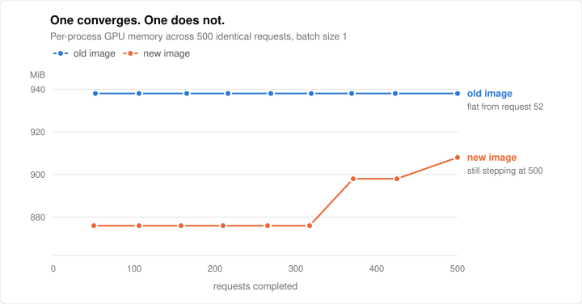
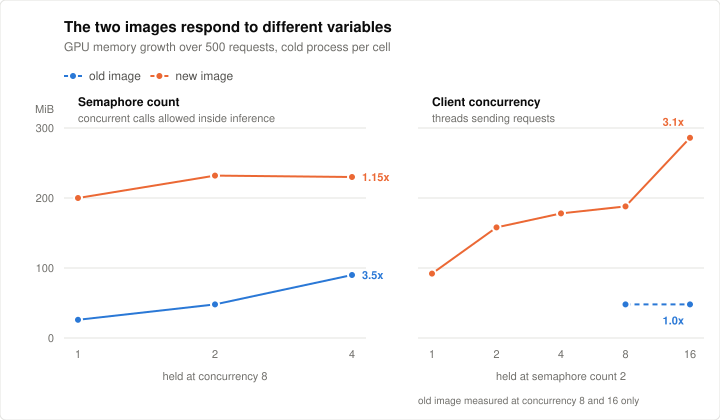

A GPU inference service climbed at 600 MiB per hour.
Linearly, all day, from roughly 40% of the card to 55% over about ten hours, and it never levelled off.

That shape is the whole story.
Rollout churn is spiky and it comes back down.
A cache warming up decelerates and flattens.
A straight line that does not bend is something being handed out and never given back.

The service had just moved to a new base image as part of a CUDA 12 to CUDA 13 and Python 3.10 to 3.12 migration.
The migration was forced: outstanding CVEs in `torch` and `onnxruntime` were hard-capped by the old image, `torch` had moved its default wheels to CUDA 13, and the only CUDA 13 `onnxruntime-gpu` build had dropped Python 3.10 entirely.
Neither axis could move alone.

So there was an obvious suspect and a bad reason to trust it.
The new image was new, therefore the new image did it.
That is a story, not a measurement.

## Experiment 1: is the image simply bigger?

Both images, same node type, same model, byte-identical 64-message batches, per-process readings.

| batches | old image | new image |
|---|---|---|
| cold | 848 MiB | 848 MiB |
| 2 | 938 MiB | 952 MiB |
| 15 | **938 MiB** | 1,134 MiB |
| 80 | not run | **1,218 MiB, still climbing** |

Cold footprint is byte-identical.
The old image converges by the second batch and does not move for the next thirteen.
The new image grows about 4 MiB per batch with no plateau across 5,120 messages.

That kills "the new image allocates more at load time".
Whatever the difference is, traffic drives it.

*The contrast is sharper than the totals suggest. This is the **most** aggressive concurrency setting tested on the old image against the **gentlest** one tested on the new image. The old image sits higher and does not move. The new image sits lower and is still stepping at request 500. Level is not the point; slope is.*

An idle check ruled out the other cheap explanation: 150 seconds with zero traffic, not one MiB of movement.
No timer, no background thread, no logging buffer.
It is the request path.

## Experiment 2: what does the growth actually track?

This is the experiment that mattered, and it only exists because the first guess about the mechanism was wrong in a useful way.

A colleague read the ONNX Runtime 1.27 source and proposed a mechanism: a CUDA stream that cannot find a free chunk of its own extends the arena with a fresh allocation rather than borrowing from another stream and synchronising.
Chunks become stream-private and are never shared back.
The prediction that follows is concrete: cap the number of concurrent inference calls and the leak should shrink.

The service already had that cap — a semaphore around the inference call.
So the test is two sweeps on the same harness, 500 requests, batch size 1, identical payload, cold process per cell.

**Axis 1, semaphore count, with client concurrency held at 8:**

| semaphore count | old image | new image |
|---|---|---|
| 1 | +26 MiB | +200 MiB |
| 2 (production) | +48 MiB | +232 MiB |
| 4 | +90 MiB | +230 MiB |
| **spread** | **3.5×** | **1.15×** |

**Axis 2, client concurrency, with semaphore count held at 2:**

| concurrency | new image | old image |
|---|---|---|
| 1 | +92 MiB | — |
| 2 | +158 MiB | — |
| 4 | +178 MiB | — |
| 8 | +188 MiB | +48 MiB |
| 16 | +286 MiB | +48 MiB |
| **spread** | **3.1×** | **1.0×** |

*The crossed pattern is the result. Each image climbs on the axis the other ignores. Note the run-to-run variance on the new image is roughly ±25%, so the small steps between adjacent points are not meaningful; the contrast between the two panels is.*

Read the two tables against each other.
The old image triples across the semaphore axis and does not move one MiB across the concurrency axis.
The new image triples across the concurrency axis and barely moves across the semaphore axis.

The two images have swapped which variable they respond to.
The old one grows with the number of calls running at the same time, and stops.
The new one grows with the number of distinct threads that have ever entered the inference path, and does not stop.

The semaphore caps how many calls are *inside* the inference call at once.
It says nothing about how many different threads take turns going in.
Sixteen threads each running strictly alone cost +286 MiB; eight threads permitted to run four at a time cost +230 MiB.
Threads, not concurrent runs.

That result rescues the substance of the proposed mechanism and kills its prediction.
Stream-private chunks were right.
The independent variable was wrong: the runtime holds its stream and its cuBLAS and cuDNN handles in a per-thread context, so the number of streams is the number of threads that have ever called into inference, not the number of calls in flight.

It also explained an earlier result that had looked like a dead end.
A probe driving an inference session directly, one call at a time, did not reproduce the leak at all — flat from request 25 to request 500 on the leaking image.
That was not a null result. It was the concurrency axis reading zero: one thread, one per-thread context, nothing to accumulate.

## Experiment 3: the obvious fix, falsified

The proposed mitigation was to lower the semaphore to 1.

On the affected image that buys +200 MiB against +232 MiB at the production setting — a difference smaller than the run-to-run variance, which was about ±25% on this measurement.
The obvious remedy does nothing, which is the same finding as experiment 2 read from the other direction.

## The mechanism, in plain language

ONNX Runtime does not call the GPU allocator for every tensor.
It keeps a pool: ask for a block, use it, hand it back, and the pool marks it free for the next request.
That pool is stream-aware, so it can tell which CUDA stream a block belongs to and avoid handing one stream's memory to another mid-flight.

The bug is a bookkeeping mismatch.
Version 1.27 allocated its memory-pattern blocks against a placeholder root stream rather than the real per-device stream.
When cleanup came around, the arena looked for chunks belonging to the real stream, did not find these, and never marked them reusable.
The block is not freed and it is not reachable for reuse.
It is a coat left in the cloakroom under a ticket number nobody issued.

One coat per worker thread, forever.

## The forty threads you did not ask for

A per-thread leak is a very polite sort of bug.
It costs you one allocation per thread, which is nothing, and it stays nothing right up until somebody hands you a pile of threads you did not know you had.

The whole mechanism is three words long: FastAPI, synchronous endpoint.

Register a plain `def` endpoint rather than an `async def` one and FastAPI will not run it on the event loop.
It cannot — a synchronous function would block every other request in the process while it waited on the GPU.
So it quietly hands your function to `anyio`'s default worker thread pool instead, which is the correct and sensible thing for it to do, and that pool holds forty threads.

Forty.
Not two, not the semaphore count, not any number written down anywhere in the service.
Forty is the `anyio` default, and it arrived in the codebase on the day somebody typed `def` instead of `async def`.

So the per-thread cost was multiplied by forty and nobody chose forty.
(Looking at you, roughly every Python service I have ever written.)

And which knob would you have reached for?
The semaphore is *called* the concurrency limit.
It is in the config file, it has a number in it, and it is one layer below the thread pool — capping how many calls get inside inference at once, completely blind to how many different threads are queueing up to take a turn.
Tuning it felt like doing something.
It was doing nothing.

Two things worth stealing from this, if your service has the same shape:

- The real lever is `anyio.to_thread.current_default_thread_limiter().total_tokens`. Throughput here was flat at roughly 150 requests per second no matter what the concurrency was, because the GPU was saturated one request at a time. Concurrency was buying queueing and paying for it in memory.
- Worker recycling was off, so no process ever got a fresh start and nothing self-healed across a nine-hour window. A finite request limit is duct tape, but duct tape that turns an unbounded climb into a sawtooth is worth having when the alternative is taking the whole card down.

## The fix was already in flight

The upstream fix — [PR #29589](https://github.com/microsoft/onnxruntime/pull/29589), "Fix usage of stream for memory pattern allocation with arena" — was merged one day after the incident.
It landed in 1.29.0 and is not in the 1.28.x line, so a patch bump does not pick it up.

The defect had shipped for three minor versions with no release note describing it.

I did not drive that fix and I did not find it before it was written.
What the investigation produced is an independent root cause, arrived at from the outside, for a bug with no public description of its symptoms.
That the two agree is the useful part.

## What I did not establish

Being clear about this matters more than the tidy version.

The per-thread mechanism is an inference from the two sweeps, not a direct measurement.
The two-line version — log the thread identifier per inference call and count distinct threads against footprint — was never run.
It should have been.

And there is a residual term.
At concurrency 1, with exactly one thread in play, the leaking image still climbs slowly and still has not plateaued at request 500.
A pure per-thread-context story predicts a flat line there.
Something smaller is also leaking, and I do not know what it is.

When a number climbs, do not guess at causes.
Find the variable it actually tracks.
