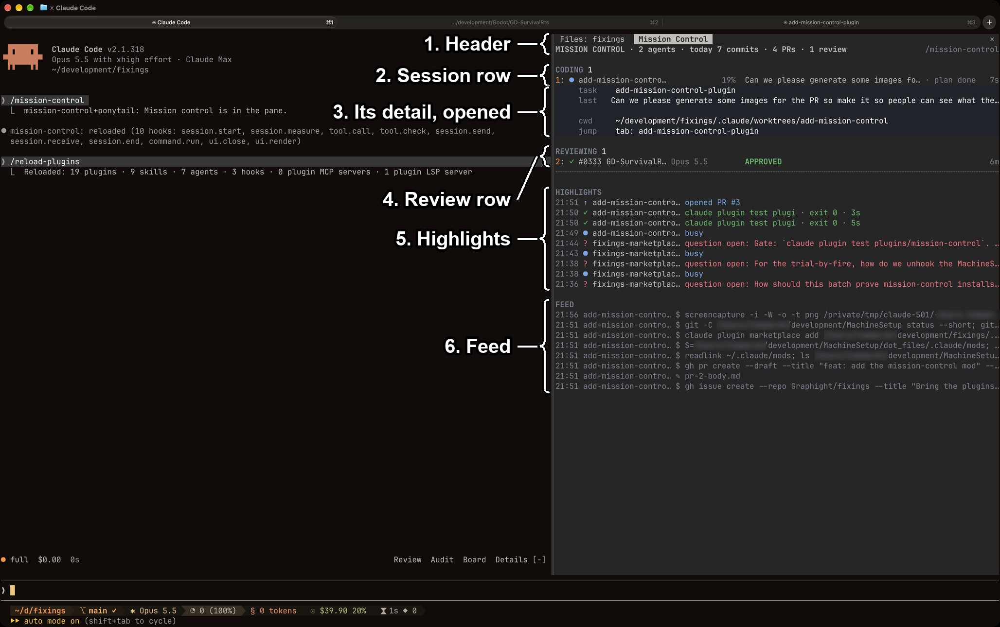

[//]: # (Intro)
At this point I do not think it is controversial to say that 2026 is the year of the agent.
As a former AI skeptic, I will admit that my opinion was humbled with the release of Opus 4.5, and it has only accelerated since.
These days, the models (and harnesses) are actually pretty darn good now and I genuinely cannot imagine developing without having one nearby.

This is all to say, I certainly **_feel_** more productive in my work and personal projects, or more likely, things are going faster and more plates are spinning.
This has brought with it the problem of corralling many agents at a time.
**_My vast intellect_** settled on the strategy of:
> _focus on one terminal tab at a time and then immediately jump to the next once it was off ticking away, rinse and repeat_ (clearly revolutionary, highly scalable, and sustainable).

This culminated in a dance of rapidly flicking through tabs looking for sessions that required my attention, burning valuable grey-matter IO on digesting the context in front of me and quickly trying to assess if I was actually needed.
I know Claude Code tried to remedy this with `claude agents` but quite frankly it does not cut the mustard for me.
Then October 1st rolled around and Anthropic released [Claude Mods](https://code.claude.com/docs/en/plugins/mods/overview) to the public.
I have had quite a bit of fun improving my agentic experience through the fracking of this feature. 
Enough so, that colleagues have started to show interest in adopting some of my practices.

This article serves as a vehicle for delivering said practices to a wider audience and is hopefully the first in a series of sharing my setup as it evolves (full-disclosure, it also helps motivate me to write in a semi-public space so two birds with one stone sounds great to me!).

# What is Mission Control?

Pictures are always nice so let us start with one:


This mod is designed to sit in an open session and play overwatch via a "side-panel" (these will come up a lot across my mods).
Unfortunately these side-panels are limited to 45% of the window-width so the mods cannot realise their potential of fullscreen real-estate.

The brief descriptions of each section are as follows: 
1. **_Header_** - The vanity section that shows how many sessions are running, your total commits today (across the repos your agents touched), PRs filed, and reviews
2. **_Session rows_** - This section captures your hard-working coding sessions (one per row) showing information such as current model, the current context consumption, and time elapsed since it last wrote to its transcript. These sessions are grouped by what they are currently doing:
   - `CODING`: actively doing things in the session and do not need you
   - `NEEDS YOU`: waiting on you for input as it is asking a question, asking for permission, or generally stuck
3. **_Details_** - By clicking to expand a row you will drill-down and see useful things like:
   - `task`: the name of the session
   - `last`: the last message you sent to the session
   - `cwd`: the current working directory of the session
   - `jump`: **_switch to the active tab_** that holds this session (thanks Ghostty 1.4.0)
   - `reply`: if there is a pending question you can answer directly from here (replies are sent via agent messages)
4. **_Review rows_** - Shows the active sessions starting with `Review PR #` (there will be another article soon about my review workflow), their review result, and how CI is doing (if present)
5. **_Highlights_** - Some canned moments across the various sessions that are worth seeing (I plan to greatly extend this once I am happier with my semantic session miner project)
6. **_Feed_** - A scrolling mass of every file edit and shell command from the agents

# How do I get it and use it?

The code for all of these lives in a repo [https://github.com/Graphight/fixings](https://github.com/Graphight/fixings/).

I am from a colony country so **_fixings_** to me means "all the nails, screws, bolts, and brackets holding things together", however, my American friends use the term **_fixin's_** as "all the side dishes and trimmings that make the meal".
This is one of those rare cases where both versions of the idiom track for the same thing so it was too good not to use it for my project as a catch-all "improve upon the product" (also there were no other popular agentic projects on GitHub with this title when I checked).

The Anthropic plugin marketplace offers a reasonably smooth experience.
To get access to these mods you can simply jump in a Claude Code session and type:
```
/plugin marketplace add Graphight/fixings

/plugin install mission-control@fixings

/mission-control
```

Whenever I drop an update you will need to:
```
/plugin update mission-control@fixings
```

### A note for Claude Desktop Users:

I did add limited support for running mission-control inside Claude Desktop but there is a limitation where you can only access / see sessions from the same modality (not a limitation from me to be clear).
While I like having access to a better renderer for the mods, I am not as comfortable using the multi-tab environment in the desktop app or just the Code environment there in general (I prefer Ghostty). 
If the experience of Claude Desktop drastically improves in the future then I will be a bit more gung-ho.
